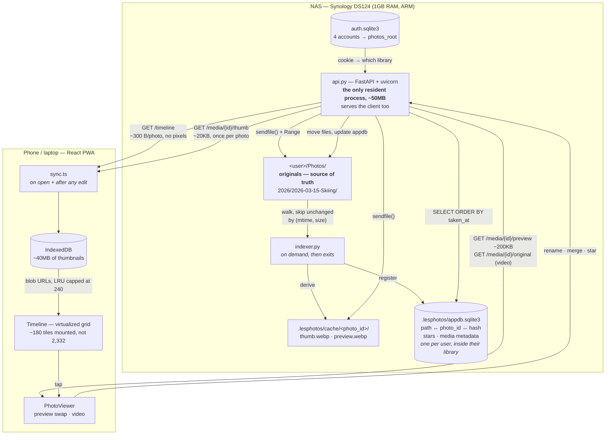

# lesphotos

A self-hosted photo library for a family, built so the **filesystem is the source of truth**.
Moments are folders. Everything else — the database, the thumbnails, the app itself — is a
disposable cache that can be deleted and rebuilt from those folders.

Runs on a Synology DS124: 1GB RAM, ARM. That constraint drives most of the design.

## How it works



**The key property:** after the first sync, scrolling makes **zero network requests**.
Thumbnails live on the device, so browsing works offline and instantly.

## Design choices

**Folders are moments.** A moment is a directory named `YYYY-MM-DD-Label`. No albums table,
no join — the filesystem already holds the answer, and it still makes sense in twenty years
with no software at all.

**`photo_id` is stable forever.** A UUID minted once per photo and kept across every
rename/move. Derivatives are keyed by it, so *moving a photo doesn't invalidate its
thumbnail*. This is why a rename is ~60ms rather than a full-library rescan.

**Nothing expensive stays resident.** One uvicorn process (~50MB idle). The indexer, ffmpeg,
and HEIC decoding are all subprocesses that exit — ffmpeg peaks ~350MB decoding HEVC, but the
server never carries it.

**Incremental by default.** The indexer skips unchanged files on `(mtime, size)` without
opening them: 2,332 files re-checked in 0.08s. The steady-state cost is ~nothing.

**Static files, plain HTTP.** Derivatives are served with `sendfile()` — Python never touches
image bytes — and cached `immutable` for a year. No WebSockets: the traffic is files, and HTTP
gives caching, range requests, and service workers for free.

**Originals are never modified.** No EXIF writes for app state. Stars live in appdb and are
mirrored to a plain-text `stars.json` as a readable backup.

**Each user has their own library, and no one is an admin.** Four accounts, four photo
folders, no cross-access — enforced structurally rather than by permission check: a
request's database and paths come from its session cookie, and nothing can name another
user's library. A library's database, thumbnails and stars live *inside its own photos
folder* (`.lesphotos/`), so they travel with the photos they describe. See
[per-user-libraries.md](docs/decisions/per-user-libraries.md).

**Thumbnails are generated in stages.** `--no-derive` registers metadata at filesystem
speed; `--derive-pending --limit N` fills in pixels a batch at a time, resumable, and the
bulk can be done on a faster machine and copied across. See
[staged-thumbnail-generation.md](docs/decisions/staged-thumbnail-generation.md).

### Deliberate limitations

- **Video: originals are HEVC, with an H.264 fallback where the host provides one.**
  ~95% of the library is HEVC — Safari/iOS decode it natively, Firefox doesn't. The
  original is served untouched by default; if playback fails the client retries
  `/media/{id}/compat`, which serves DSM's own transcode (720×960 against the original's
  1920×1440, so quality is preserved for everyone who didn't need the fallback). 1,663 of
  1,678 videos have one; the rest simply don't play in Firefox.
- **No shared/family library.** Each user has their own; a genuinely shared timeline
  would be real work (see [per-user-libraries.md](docs/decisions/per-user-libraries.md)).
- **Sync fetches every thumbnail.** ~390MB at 100GB — fine against a ~3GB browser quota.
  Needs windowing somewhere past 300GB; see
  [client-cache-scaling.md](docs/decisions/client-cache-scaling.md).
- **All work is synchronous in the request.** No job queue. Fine at 54 photos in 296ms.

## Layout

```
server/
  api.py          FastAPI: /timeline, /media/{id}/{thumb,preview,original,metadata},
                  /index, /login, /favorite, /moments/{rename,merge,create,auto-generate}
                  and, in production, the built client itself
  auth.py         users, scrypt passwords, signed session tokens
  config.py       where everything lives - Library(photos_root) -> db/cache/stars paths
  manage.py       user administration over SSH (add-user, passwd, list-users)
  indexer.py      walks a library, writes derivatives, incremental + resumable
  platform_hosts.py  host-specific workarounds (Synology @eaDir posters), kept
                  out of the core so the rest of the app stays portable
  reorganize.py   moves files, updates appdb — all mutations go through here
  geocoding.py    opt-in reverse geocoding for moment name suggestions
  appdb/          SQLite schema + helpers
  fakelib/        synthetic library generators for scale testing
client/web/       React + Vite PWA
  src/sync.ts     full relist + diff against IndexedDB
  src/db.ts       Dexie schema (thumbnail cache + bounded full-res LRU)
  src/thumbnails.ts   object-URL store, LRU capped
  src/Timeline.tsx    virtualized moment-grouped grid
docs/decisions/   why things are the way they are
```

## Running it

Deploying to the NAS is [deploy/README.md](deploy/README.md). For local development:

```bash
uv sync

# one account per person, each pointed at its own photos folder
export LESPHOTOS_DATA_DIR=./server/data
uv run python server/manage.py add-user alice ./server/data/photos/alice

# index: metadata first (fast), then thumbnails in batches
uv run python server/indexer.py --user alice --no-derive
uv run python server/indexer.py --user alice --derive-pending --limit 200
uv run python server/indexer.py --user alice --status

# serve. LESPHOTOS_SECRET is required - the server refuses to start without
# it, because a random per-process value logs everyone out on restart.
LESPHOTOS_SECRET=$(python3 -c 'import secrets;print(secrets.token_hex(32))') \
  uv run uvicorn api:root_app --port 8001 --app-dir server

# client
cd client/web && npm install && npm run dev     # http://localhost:5173
```

`api:root_app` serves both the API (under `/lesphotos-api`) and the built client;
`api:app` is the API alone.

`vite.config.ts` proxies `/lesphotos-api/*` to `:8001` so the browser sees one origin.

Service workers only activate in a production build — to test offline behaviour:

```bash
cd client/web && npm run build && npm run preview -- --port 4173
```

## Measured

On the 2,332-item test library (2,288 jpg, 6 mov, 3 heic; 8.4GB originals):

| | |
|---|---|
| server idle | **~50MB**, one process, no container |
| `/timeline` (500 photos) | 51ms, 147KB |
| one thumbnail | 1.4ms, ~20KB |
| 60 thumbnails, 12 parallel | 42ms, 1.1MB |
| rename a moment | 62–73ms |
| incremental index (nothing changed) | 0.08s, 32MB |
| full client sync | 32s → 42MB in IndexedDB |
| scrolling 60 screens | **0 requests**, heap flat at 9.5MB |
| derivative cache | 427MB for 8.4GB of originals (~5%) |
